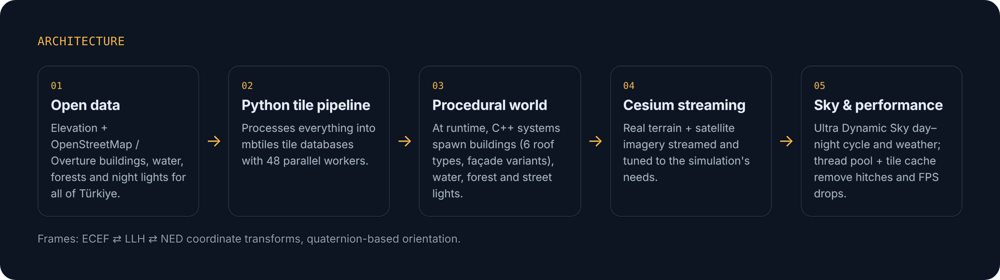

# Flight Simulation World: Unreal Engine × Cesium

**Baykar · Long-term Intern, Simulation Systems · Feb – Aug 2026 (7 months)**

This repo summarises my internship work on the visual world of an aircraft simulator: a real-time, geographically accurate model of Türkiye, rendered in **Unreal Engine** with **Cesium for Unreal** and written mostly in **C++**.

> 🔒 The code, assets and screenshots are company property, so this repository is a write-up only. It contains no source code and no internal material.

## Architecture

## What I built

**🌍 World & terrain**
- Developed the Unreal Engine + Cesium for Unreal flight-simulation environment in C++.
- Tuned how real terrain and satellite imagery stream in, to match what the simulation needs.

**🏙️ Procedural world generation**
- Wrote a runtime system that generates **buildings, water, forests and night lights** from **OpenStreetMap** and **Overture** data.
- Gave buildings variety with **6 roof types** and façade variants, and put all settings in one control panel.

**⚙️ Data pipeline**
- Built a **Python pipeline running on 48 parallel workers** that processes elevation and building data for **all of Türkiye** into **mbtiles** tile databases.

**🌗 Sky, weather & night**
- Set up the day–night cycle, weather and night look with **Ultra Dynamic Sky**.
- Rendered geo-referenced **street lights as materials instead of light sources**, which keeps thousands of lights cheap to draw.

**🧭 Math**
- **ECEF ⇄ LLH ⇄ NED** coordinate transforms and quaternion-based orientation.

**🚀 Performance**
- Measured and removed hitches and FPS drops with a **thread pool** and a **tile cache**.

## Stack

`C++` · `Unreal Engine` · `Cesium for Unreal` · `Ultra Dynamic Sky` · `Python` · `OpenStreetMap` · `Overture Maps` · `mbtiles` · `Blender` · procedural meshes · LOD · terrain streaming

---

Built by <a href="https://github.com/mtaiea">Mustafa Talha Arı</a>.
